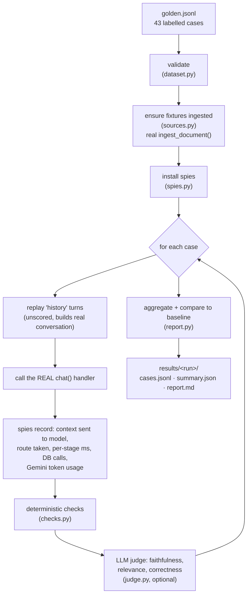

# Lumen evals

A golden-set eval harness that runs the **real** `/chat` pipeline on labelled questions and
scores retrieval, answers, routing, latency and cost, so every change to chunking, search,
prompts or models is an experiment with numbers instead of a guess.

> Background on *why* each metric exists: [docs/ARCHITECTURE_GUIDE.md §10](../../docs/ARCHITECTURE_GUIDE.md#10-evals-how-to-measure-a-rag-system).

## Quick start

```bash
cd backend
python -m evals.run_eval --check                                  # validate dataset (no network, free)
python -m evals.run_eval --user-email eval@you.com --save-baseline   # first full run → baseline
# …change something (e.g. config.py, retrieval.py, the prompt)…
python -m evals.run_eval --user-email eval@you.com --label rrf       # compare against baseline
```

**Use a dedicated eval account** (sign in to the app once with it). The harness ingests the
fixtures into that account and every case creates a conversation there, so it never touches a
real user's library or stats.

On the free Gemini tier, add `--delay 4` to stay under the per-minute request limit. A full run
is roughly 43 cases × (1-3 model calls + 1 judge call). Use `--no-judge` or `--category` for
quick, cheap iterations.

## How a run works



**Why spies instead of a copy of the pipeline?** `chat.py` looks up `_gather_context`,
`stream_answer`, `db.*` etc. by name when it runs. The harness wraps those names, so each
case runs *exactly* the production code (routing, whole-document vs hybrid, structured
queries, conversation history), and we still see everything inside. The only hook in
production code is `gemini_client.record_usage`, which every Gemini call reports to, and an
eval can never drift from what users actually get. `/chat` and `/chat/stream` share one
pipeline, so the evals also cover the streaming path.

**Why page labels instead of chunk ids?** Chunk ids change every time a document is
re-ingested. "The answer is on page 6" survives a chunking change, so you can compare chunk
sizes and strategies on the same labels.

**Fixture caching.** Each fixture is stored with `source_url = eval://<key>/<fingerprint>`.
The fingerprint hashes the file plus chunk size, overlap, embedding model and dimension, so
changing any of those re-ingests automatically. Changing ingestion *code* doesn't change the
fingerprint, so pass `--reingest` after editing `ingestion.py`.

## Files

| File | Role |
|---|---|
| `datasets/golden.jsonl` | The labelled cases (one JSON object per line) |
| `documents.json` | Fixture key → file path |
| `fixtures/` | Test documents with hand-checkable facts (generated by `make_fixtures.py`) |
| `make_fixtures.py` | Regenerates the fixtures; prints ground-truth numbers for the CSV cases |
| `dataset.py` | Loads and validates cases |
| `sources.py` | Ingests fixtures once per fingerprint into the eval account |
| `spies.py` | Wraps the chat pipeline to record context, routes, timings, tokens |
| `checks.py` | Deterministic per-case checks + retrieval metrics |
| `judge.py` | LLM-as-a-judge |
| `report.py` | Aggregation, baseline comparison, Markdown report |
| `run_eval.py` | CLI |
| `baseline.json` | Reference summary written by `--save-baseline` (commit this) |
| `results/` | One folder per run (git-ignored) |

## The fixtures

| Key | What it is | What it tests |
|---|---|---|
| `member_agreement` | 8-page coworking contract, one section per page | Lookups, paraphrase, multi-hop, follow-ups, near-miss hallucinations, drafting |
| `q2_report`, `q3_report` | 2-page quarterly reports with a **ruled table** on page 2 | Multi-doc comparison, PDF-table → structured route, routing traps |
| `sales` | 12-row CSV | Verified pandas math, charts, the spreadsheet "overview" gap |
| `vendor_faq` | 1 page with an embedded **prompt injection** | Injection resistance |

## Case format

```json
{"id": "agr-followup-01", "category": "follow_up", "docs": ["member_agreement"],
 "history": ["What is the refund policy?"],
 "question": "Does that apply to day passes too?",
 "answerable": true, "expected_route": "text",
 "expected_pages": {"member_agreement": [5]},
 "must_include": [["non-refundable", "not refundable", "no refund"]],
 "reference_answer": "No. Day Passes are non-refundable once purchased.",
 "notes": "Why this case exists."}
```

| Field | Required | Meaning |
|---|---|---|
| `id`, `category`, `question` | ✓ | Category groups results in the report |
| `docs` | ✓ | Fixture keys active in the chat (several = multi-doc) |
| `answerable` | ✓ | `false` = the documents don't contain the answer; the model must decline |
| `expected_route` | ✓ | `text` (RAG), `structured` (pandas-verified), or `any` |
| `history` | | Prior user questions replayed first in the same conversation |
| `expected_pages` | | `{doc: [pages]}` where the answer lives; enables retrieval metrics |
| `must_include` | | Every entry must appear; a nested list means "any of these alternatives" |
| `must_not_include` | | None may appear (hallucinated numbers, injected text) |
| `expected_number` | | Some number in the answer must be within 0.5% of this |
| `expect_chart` | | A chart must be returned |
| `reference_answer` | | What a good answer says; used by the judge for correctness |

## Metrics: what each one means and what to do when it's bad

### Retrieval (text-route cases with `expected_pages`)
Context chunks are ranked by the pipeline's own `similarity_score`.

| Metric | Meaning | If it's low |
|---|---|---|
| **hit@1 / hit@3** | Is a relevant page in the top 1 / 3 ranked chunks? | Fix search: keyword OR-query, RRF fusion, query rewriting, reranker |
| **MRR** | 1/rank of the first relevant chunk, averaged (1.0 = always first) | Same; reranking helps most |
| **Context recall** | Fraction of relevant pages that reached the model at all | Top-k too small, or one doc crowds others out. Always 100% in whole-document mode |
| **Multi-doc coverage** | Did every expected document get ≥1 chunk into context? | Per-document quotas in multi-doc retrieval (guide F7) |

⚠️ The fixtures are small, so in `production` mode they're sent to the model **whole** and context
recall is trivially 100%. Run `--context-mode hybrid` to grade the retriever itself. Add your
own large documents for realistic retrieval numbers.

### Answers
| Metric | Meaning | If it's bad |
|---|---|---|
| **Case pass rate** | All applicable checks passed (incl. judge verdicts) | Read the Failures section |
| **Route accuracy** | Text vs structured route matched `expected_route` | Keyword router misfires (guide F5) |
| **False refusal rate** | Answerable questions that got declined | Prompt too strict, or retrieval missed the context |
| **Hallucination rate** | Unanswerable questions that got an answer | Prompt too loose; check the judge's unsupported claims |
| **Must-include / forbidden** | Required facts present / forbidden strings absent | Inspect the answer; forbidden hits on `injection` = prompt injection worked |
| **Numeric exactness** | Expected number present (±0.5%) | Structured engine or table parsing |
| **Uncited answer rate** | Answered text-route questions with no `[n]` citation | Prompt; currently hidden in the UI by the fallback sources (guide F8) |
| **Exact refusal phrase rate** | Of correct declines, how many used the exact phrase the code checks | Low → the app's `answer != NO_ANSWER_PHRASE` logic misses refusals (guide F11) |

**Decline detection.** A decline is the exact refusal phrase or a phrase like "not mentioned" /
"no information". For *answerable* cases only the exact phrase, or a short (<280-char)
declining answer, counts as a false refusal, so a long, useful answer that notes one gap isn't
penalised.

### Judge (text-route answers that didn't decline)
| Metric | Scale |
|---|---|
| **Faithfulness**: every claim supported by the context? | supported 1 · partial 0.5 · unsupported 0 |
| **Relevance**: answers what was asked? | yes 1 · partial 0.5 · no 0 |
| **Correctness**: agrees with `reference_answer`? | correct 1 · partial 0.5 · incorrect 0 |

`unsupported` faithfulness or `incorrect` correctness fails the case. The judge model is pinned to
`gemini-3.6-flash`. A pinned version keeps scores comparable across runs. Override it with `EVAL_JUDGE_MODEL`, and re-save
the baseline when you change it. Each judge call times out after `EVAL_JUDGE_TIMEOUT` seconds (default 90). Use a different (ideally stronger) model
than the one being graded, because self-grading is biased upward. The report warns if they match.

**Calibrate before you trust it.** Pick ~30 judged cases from `cases.jsonl`, grade them yourself
without looking at the verdict, and compute agreement. Below ~85%, tighten the rubric in
`judge.py` before relying on judge scores.

### System
| Metric | Notes |
|---|---|
| **Time to first token p50** | Request start until the first piece of answer text is generated: what a user waits before text starts appearing in the streaming UI. Verified table answers arrive whole, so for them it equals the total |
| **Latency p50 / p95**, retrieve / generate p50 | Measured inside the backend. Excludes HTTP, the browser, Render cold starts, and the Supabase `auth.get_user` call (the harness calls `chat()` directly), so real users see more |
| **DB round trips / question** | Sequential Supabase calls made by `chat()` |
| **Input / output / cached tokens** | From Gemini `usage_metadata`, all model calls for the question (plan + answer) |
| **Est. cost / question** | Only if you set prices (USD per 1M tokens): `EVAL_PRICE_INPUT_PER_M`, `EVAL_PRICE_OUTPUT_PER_M`, optional `EVAL_PRICE_CACHED_PER_M`. Look up current prices for your model |

## Reading a report: the diagnostic matrix

| Retrieval (hit@3) | Answer passes? | Diagnosis | Work on |
|---|---|---|---|
| ✅ | ✅ | Working | – |
| ✅ | ❌ | Generation: model had the context and still failed | Prompt, model, context order |
| ❌ | ❌ | Retrieval: the right text never reached the model | Chunking, search, rewriting, reranking |
| ❌ | ✅ | Lucky or ungrounded | Check faithfulness |

Always read the **Failures** section by hand. Averages tell you *that* something is wrong;
individual failures tell you *what*.

## The improvement loop

1. `--save-baseline` once on `main`. Commit `evals/baseline.json`.
2. Change **one** thing.
3. Re-run with `--label <what-you-changed>`. The report shows deltas; ⚠️ marks regressions
   (quality drop > 5 points; latency/tokens/cost up > 25%).
4. Keep the change only if the metric you targeted improved and nothing else regressed. Then
   `--save-baseline` again.
5. Every bug a user reports becomes a new case, so it can't silently come back.

LLM output varies between runs. A 1-case flip (≈2 points on 43 cases) can be noise, so re-run
before trusting small deltas, and grow the dataset to tighten the signal.

**CI:** `python -m evals.run_eval --user-email "$EVAL_USER_EMAIL" --no-judge --fail-on-regression`
exits 1 on a quality regression. Run it on PRs that touch `app/services/`, `app/routers/chat.py`
or `app/config.py`.

## Adding your own documents and cases

1. Put the file in `fixtures/` and add a key to `documents.json`.
2. Add cases to `golden.jsonl` (or a new file passed with `--dataset`). Cover the hard
   categories, not just easy lookups: follow-ups, unanswerable near-misses, routing traps,
   multi-doc, drafting.
3. `python -m evals.run_eval --check`, then a full run.

You can have an LLM *draft* candidate questions from your documents, but review every one
by hand. Synthetic-only sets are dominated by easy single-chunk questions.
