# Lumen: The Complete Architecture & RAG Engineering Guide

> A mentor's walkthrough of how Lumen works, why it is built this way, what is wrong with it,
> and how to make it faster, cheaper and measurably better.
>
> Every claim about the code links to the exact line. Every term is defined the first time it
> appears (look for **📘 Concept** boxes), and there is a full glossary at the end.

---

## Table of contents

1. [Lumen in 60 seconds](#1-lumen-in-60-seconds)
2. [RAG from first principles](#2-rag-from-first-principles)
3. [The tech stack, and why each piece is there](#3-the-tech-stack-and-why-each-piece-is-there)
4. [System architecture: the big picture](#4-system-architecture-the-big-picture)
5. [Flow 1: Ingestion (how a file becomes searchable)](#5-flow-1-ingestion)
6. [Flow 2: Chat (how a question becomes a cited answer)](#6-flow-2-chat)
7. [Data model](#7-data-model)
8. [Security model](#8-security-model)
9. [Senior architect review: what's good, what's broken](#9-senior-architect-review)
10. [Evals: how to measure a RAG system](#10-evals-how-to-measure-a-rag-system)
11. [Latency: where the time goes and how to get it back](#11-latency)
12. [Cost: token math and the levers that matter](#12-cost)
13. [The roadmap: what to do, in what order](#13-the-roadmap)
14. [Glossary](#14-glossary)
15. [How to keep learning](#15-how-to-keep-learning)

---

## What changed (November 2026)

| Change | Where | Verified by |
|---|---|---|
| Migrated to the `google-genai` SDK (F14) | [gemini_client.py](../backend/app/services/gemini_client.py) | Embeddings identical to the old SDK (cosine 1.000000); 43-case eval |
| Pinned the model to `gemini-3.5-flash-lite` (F13) | [config.py](../backend/app/config.py) | It's what `-latest` resolved to, so behaviour is unchanged |
| Streaming answers over SSE (F12) | `POST /chat/stream`, [api.ts](../frontend/lib/api.ts), [ChatPanel.tsx](../frontend/components/ChatPanel.tsx) | Live: first text at 5.0 s vs 7.25 s total on a long answer |
| Durable ingestion queue (F15) | [worker.py](../backend/app/worker.py), `ingestion_jobs`, `lumen-uploads` bucket | Live: crashed worker → job reclaimed, partial chunks removed, 8 clean chunks |
| Tracing and per-request logs (F16) | [tracing.py](../backend/app/tracing.py) | Spans, tokens and cost checked against an in-memory Langfuse exporter |
| Fixed silent log loss | [main.py](../backend/app/main.py) | Before, app INFO logs were dropped because only uvicorn's loggers were configured |

---

## 1. Lumen in 60 seconds

Lumen is a **grounded document chatbot**. You give it sources (PDF, CSV, XLSX, a web page or a
YouTube video), then ask questions. It answers **only from those sources**, cites the exact
passage (`[1][2]`), shows how closely each passage matched, and says *"I don't know based on the
provided document"* instead of making things up.

It has **two answering engines**:

| Engine | Used for | How the answer is produced | Trust label in UI |
|---|---|---|---|
| **Text RAG** | Prose questions ("summarize", "what does clause 4 say") | Retrieve passages → LLM writes answer from them | `Sources checked` / `Text only · verify` (if it drew a chart) |
| **Structured query** | Numeric/table questions ("average of column X") | LLM writes a small JSON *plan* → **pandas** does the math | `Verified data` |

That second engine is the most sophisticated idea in the codebase: **the LLM never does
arithmetic**. It only translates English into a constrained query plan, and deterministic code
computes the number. Keep that principle. It is exactly what a senior engineer would do.

---

## 2. RAG from first principles

### 2.1 The problem RAG solves

An LLM (Large Language Model) like Gemini knows what was in its training data. It does **not**
know your PDF. You have three ways to give it that knowledge:

| Approach | How | Problem |
|---|---|---|
| **Fine-tuning** | Retrain the model on your documents | Slow, expensive, can't cite sources, must retrain for every new doc |
| **Stuff everything in the prompt** | Paste the whole document every time | Expensive per question, hits context limits, quality drops in very long contexts |
| **RAG** | Find only the *relevant* parts, paste those | Needs a good search system. **That is the whole game.** |

> **📘 Concept: RAG (Retrieval-Augmented Generation).** Two steps: **Retrieve** the few passages
> most relevant to the question, then **Generate** an answer with the LLM, using those passages
> as its only allowed knowledge. The LLM becomes a *reader and writer*, not a *memory*.

### 2.2 The mental model you should carry forever

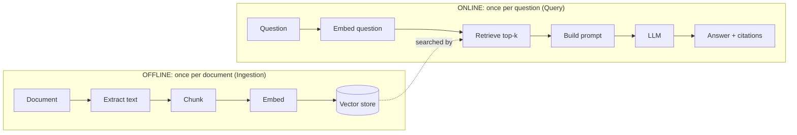

**Golden rule of RAG: the LLM can only be as good as what you retrieve.** If the right passage
isn't in the top-k, no prompt engineering on earth will save the answer. That's why 70% of
improving a RAG system is improving **retrieval**, and why evals must measure retrieval
*separately* from generation (section 10).

### 2.3 The five core concepts

> **📘 Concept: Token.** The unit LLMs read and bill by. Roughly ¾ of an English word
> (`"Lumen is great"` ≈ 4 tokens). Lumen counts tokens with `tiktoken`'s `cl100k_base` encoder
> ([ingestion.py:20](../backend/app/services/ingestion.py#L20)). Note: that is *OpenAI's*
> tokenizer, so Gemini's real count differs a little. Fine for sizing chunks, not for billing.

> **📘 Concept: Chunk.** A slice of a document small enough to be a precise search result.
> Lumen uses **500 tokens per chunk with 50 tokens of overlap**
> ([config.py:31-32](../backend/app/config.py#L31-L32)). *Overlap* means the last 50 tokens of
> chunk N are repeated at the start of chunk N+1, so a sentence cut at a boundary still appears
> whole in one of them.
>
> ```
> tokens:  [0 ............ 500]
>                     [450 ............ 950]
>                                  [900 ............ 1400]
>                     ↑ 50-token overlap ↑
> ```

> **📘 Concept: Embedding.** A list of numbers (a *vector*) that represents the *meaning* of a
> text. Lumen's are 768 numbers long. Texts with similar meaning get vectors pointing in similar
> directions, so *"cancel my subscription"* and *"how do I stop my plan"* land close together
> even though they share no words.

> **📘 Concept: Cosine similarity.** How aligned two vectors are: 1.0 = same direction (same
> meaning), 0 = unrelated. pgvector's `<=>` operator returns cosine **distance**, and Lumen
> converts it: `similarity = 1 - distance`
> ([schema.sql:201](../backend/db/schema.sql#L201)).

> **📘 Concept: Top-k.** "Return the k best matches." Lumen uses `TOP_K = 8`
> ([config.py:34](../backend/app/config.py#L34)).

### 2.4 Two kinds of search, and why you need both

| | **Semantic (dense) search** | **Keyword (sparse/lexical) search** |
|---|---|---|
| Matches on | Meaning | Exact words |
| Good at | Paraphrase, synonyms, vague questions | Names, IDs, numbers, jargon ("SKU-4471", "Section 12.3") |
| Bad at | Rare exact terms (embeddings "blur" them) | Synonyms ("car" won't match "automobile") |
| In Lumen | pgvector cosine search | Postgres full-text search (`tsvector`, `ts_rank`) |

> **📘 Concept: Hybrid search.** Run both and merge the results. Lumen merges with
> `0.7 × semantic + 0.3 × keyword` ([retrieval.py:86-94](../backend/app/services/retrieval.py#L86-L94)).
> (Section 9 explains why this specific merge formula is flawed, and what to use instead.)

---

## 3. The tech stack, and why each piece is there

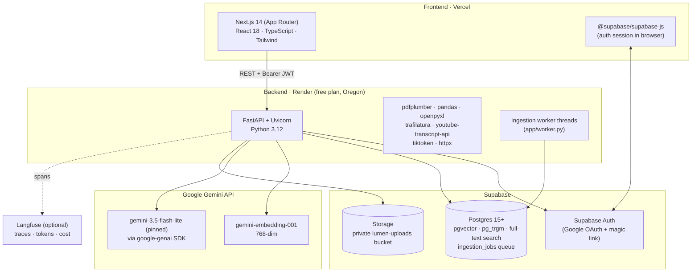

| Layer | Tech | Role in Lumen | Why it's a good choice |
|---|---|---|---|
| UI | **Next.js 14 + React** | Chat, library sidebar, source drawer, charts | Industry standard; easy deploy on Vercel |
| UI charts | **Custom SVG** ([LumenChart.tsx](../frontend/components/LumenChart.tsx)) | Renders ` ```chart ` JSON blocks | No heavy chart dependency |
| API | **FastAPI** | Routers: `/documents`, `/chat`, `/chat/stream` (SSE), `/stats` | Async-capable, auto OpenAPI docs at `/docs`, Pydantic validation, `StreamingResponse` for token streaming |
| Validation | **Pydantic** ([schemas.py](../backend/app/models/schemas.py)) | Request/response shapes | Type-safe contracts between FE and BE |
| PDF | **pdfplumber** | Text per page + table detection | Good table extraction for native (non-scanned) PDFs |
| Sheets | **pandas + openpyxl** | CSV/XLSX → tables; executes structured queries | Deterministic math |
| Web | **trafilatura** | Extracts article text from HTML, drops nav/ads | Best-in-class "readability" extraction |
| Video | **youtube-transcript-api**, fallback **Gemini video understanding** | Transcript → timed ~2-min paragraphs | Captions are free; Gemini works when YouTube blocks cloud IPs |
| Tokenizer | **tiktoken** | Chunk sizing, batch sizing | Fast |
| DB | **Supabase Postgres** | Documents, chunks, tables, conversations, logs | One DB for relational + vector + full-text = less infra |
| Vectors | **pgvector** | `vector(768)` column, `<=>` cosine operator | No separate vector DB to run |
| Auth | **Supabase Auth** | Google sign-in, magic link, JWTs | Free, integrates with RLS |
| LLM | **Gemini** via **google-genai** SDK ([gemini_client.py](../backend/app/services/gemini_client.py)) | Embeddings, answers, table query plans, video transcription | Cheap, generous free tier, long context. One wrapper owns timeouts, retries, streaming and token accounting |
| Queue | **Postgres table + `FOR UPDATE SKIP LOCKED`** ([worker.py](../backend/app/worker.py)) | Durable ingestion jobs with heartbeats and retries | No Redis or extra service; survives restarts |
| Files | **Supabase Storage** (private bucket) | Holds uploads until the worker processes them | The instance's own disk is wiped on every restart |
| Tracing | **Langfuse** (optional) + structured log lines ([tracing.py](../backend/app/tracing.py)) | Per-stage timings, time to first token, tokens, cost | Open-source; logs work even without an account |
| Hosting | **Render** (BE), **Vercel** (FE) | `render.yaml` blueprint | Free tiers (with cold starts) |

---

## 4. System architecture: the big picture

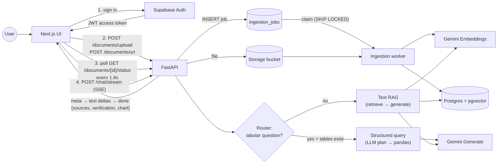

**Code layout follows a clean pattern** (keep it):

```
routers/   → HTTP only: parse request, check auth, call services, shape response
services/  → business logic: ingestion, retrieval, generation, spreadsheet
db.py      → every database query lives here, every one scoped by user_id
config.py  → every tunable knob (model names, chunk sizes, weights) in one place
```

> **📘 Concept: Separation of concerns.** Routers stay thin; logic lives in services. This is
> what makes it possible to write an eval harness (section 10) that calls `_gather_context()`
> and `stream_answer()` directly, without spinning up HTTP. All Gemini calls go through
> `services/gemini_client.py`, and every request gets a `tracing.Trace` passed down explicitly.

---

## 5. Flow 1: Ingestion

### 5.1 The request lifecycle

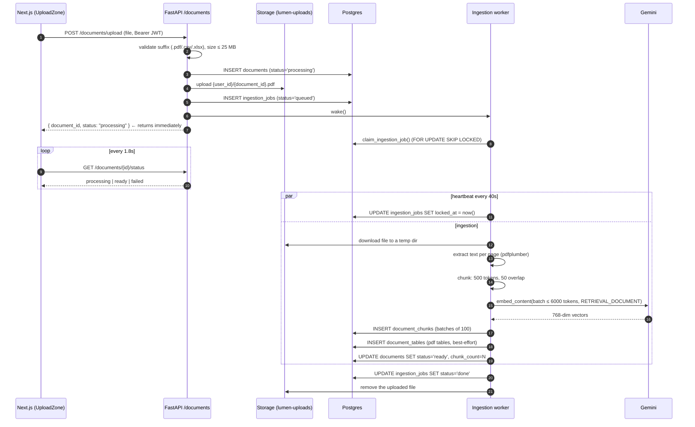

> **📘 Concept: Asynchronous ingestion + a durable queue.** Embedding a 100-page PDF can take a
> minute, so the API returns a `document_id` instantly and the UI *polls* a status endpoint
> ([UploadZone.tsx](../frontend/components/UploadZone.tsx)). The work itself is a row in
> `ingestion_jobs`, not an in-memory task, so a restart can't lose it:
>
> - **Claiming:** `claim_ingestion_job` uses `FOR UPDATE SKIP LOCKED`, so any number of worker threads
>   or instances can poll safely. Each job goes to exactly one worker.
> - **Heartbeat:** while a job runs, `locked_at` is refreshed. If Render restarts mid-ingestion, the
>   heartbeat stops. After `INGESTION_STALE_SECONDS` (120s) the next worker reclaims the job, deletes
>   any partial chunks, and starts again.
> - **Retries:** unusable input (scanned PDF, damaged file, 404 page, private video) fails at once
>   with a readable message. Rate limits, Gemini overload and network blips retry after 15s, then
>   60s, up to 3 attempts.
> - **Where it runs:** inside the API process by default. Set `INGESTION_WORKER_ENABLED=false` and
>   run `python -m app.worker` to make it its own service.

### 5.2 One pipeline per source type

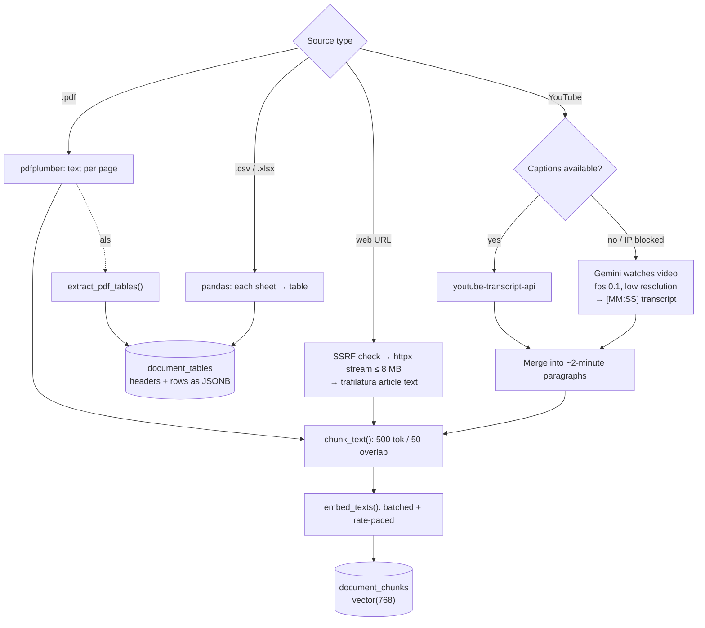

Key design decisions worth understanding:

1. **Spreadsheets are NOT embedded** ([ingestion.py:195-201](../backend/app/services/ingestion.py#L195-L201)).
   Turning a 10,000-row table into text chunks destroys its structure, and an LLM can't reliably
   add up numbers it reads from prose. Tables go to `document_tables` as JSON, and math happens in
   pandas. **Correct call.**
2. **PDF table extraction is best-effort** ([ingestion.py:213-218](../backend/app/services/ingestion.py#L213-L218)).
   A broken table never makes the document unusable. Good resilience thinking.
3. **Type inference** ([ingestion.py:87-97](../backend/app/services/ingestion.py#L87-L97)): a
   column is `numeric` if ≥80% of its values parse as numbers. That handles messy real-world sheets.
4. **SSRF protection** ([ingestion.py:24-36](../backend/app/services/ingestion.py#L24-L36)).
   Before fetching a user-supplied URL, the hostname is resolved and rejected if it points to a
   private IP, and that check is **repeated after redirects** (line 45). See section 8.

### 5.3 Embeddings: batching and rate pacing

[embeddings.py](../backend/app/services/embeddings.py) is a nicely engineered module:

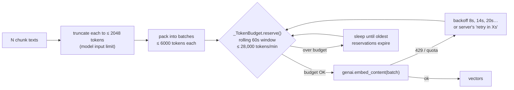

> **📘 Concept: Batching.** Sending 50 texts in one API call instead of 50 calls. Saves 49
> network round trips. Huge for ingestion speed.

> **📘 Concept: Rate limiting / TPM (Tokens Per Minute).** APIs cap usage per minute. Hitting the
> cap returns **HTTP 429** ("Too Many Requests"). `_TokenBudget` is a **client-side token bucket
> (sliding window)**: it waits *before* calling, instead of hammering the API and getting
> rejected. That's more predictable than retrying blindly.

> **📘 Concept: Task type.** Gemini embeddings take a hint: `RETRIEVAL_DOCUMENT` for chunks,
> `RETRIEVAL_QUERY` for questions. The model embeds them slightly differently so that a *question*
> lands near its *answer*, not near other questions. Lumen uses both correctly.

> **📘 Concept: Matryoshka embeddings (MRL).** `gemini-embedding-001` natively produces 3072
> dimensions, but it is trained so the first N dimensions are still meaningful on their own.
> Lumen requests 768 (`output_dimensionality`), which gives 4× less storage and faster search at
> a small quality cost. Truncated vectors aren't unit-length, but cosine similarity normalizes
> anyway, so the `<=>` search is still correct. (If you ever switch to dot-product `<#>`, you must
> normalize first.)

⚠️ **Hidden coupling:** the *same* `_budget` object paces **both** ingestion and chat-time query
embedding ([retrieval.py:9-10](../backend/app/services/retrieval.py#L9-L10) →
[embeddings.py:99](../backend/app/services/embeddings.py#L99)). If one user is ingesting a large
PDF and the budget is full, **another user's chat question waits up to 60 seconds** just to embed
a 15-token question. More in section 11.

---

## 6. Flow 2: Chat

### 6.1 The full decision tree

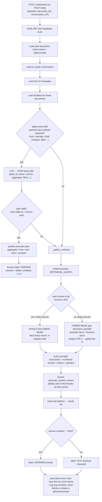

### 6.2 Step by step

**Step 1: Routing** ([chat.py:159](../backend/app/routers/chat.py#L159),
[spreadsheet.py:44-50](../backend/app/services/spreadsheet.py#L44-L50)).
A regex looks for whole words like `average`, `sum`, `chart`, `compare`, `table`. Whole-word
matching was added after "summarize" kept triggering "sum". That's a good fix, but keyword
routing is still fragile (section 9).

> **📘 Concept: Query routing / intent classification.** Deciding *which pipeline* should answer
> a question. Production systems usually use a small LLM classifier or embedding-based "semantic
> router" rather than keywords.

**Step 2: Structured path** ([spreadsheet.py:125-192](../backend/app/services/spreadsheet.py#L125-L192)).
The LLM sees only table *metadata* (ids, names, columns), never the rows, and returns JSON like:

```json
{"table_id": "…", "action": "aggregate", "column": "Revenue", "aggregate": "mean",
 "filters": [{"column": "Region", "operator": "eq", "value": "West"}]}
```

Then the code checks every field against an allow-list (`_ACTIONS`, `_AGGREGATES`, `_OPERATORS`,
real column names) and pandas computes the result. **No model-generated code is ever executed.**

> **📘 Concept: Constrained generation / tool use.** Instead of letting the LLM produce free text
> (or worse, Python you `exec()`), you make it fill a strict schema that your code validates and
> executes. This is the safe pattern behind "function calling", "tool use" and "text-to-SQL".
> Lumen does it by hand. Gemini's **structured output** mode (`response_schema`) would make the
> JSON guaranteed-valid instead of regex-stripped
> ([spreadsheet.py:79-80](../backend/app/services/spreadsheet.py#L79-L80)).

**Step 3: Context gathering, two modes** ([chat.py:65-103](../backend/app/routers/chat.py#L65-L103)).

- **Whole-document mode** (≤ 60 chunks ≈ 30k tokens total): send *everything*, in reading order.
  This was added (your current uncommitted change) because top-k retrieval fails on broad
  questions like "summarize this". The top 8 chunks of a 40-chunk doc aren't a summary.
  This is the **"long-context vs RAG" trade-off**: better answers on broad questions, but ~4×
  the cost per question (section 12).
- **Hybrid mode**: for each document (in parallel threads), run semantic + keyword search, merge,
  then take the global top 8.

**Step 4: Prompt construction** ([generation.py:43-60](../backend/app/services/generation.py#L43-L60)).

```
┌──────────────────────────────────────────────┐
│ SYSTEM_INSTRUCTIONS (rules, refusal phrase,  │  ← identical every request
│ citation format, chart JSON format)          │
├──────────────────────────────────────────────┤
│ Context chunks:                              │
│ [1] (report.pdf, page 3): …500 tokens…       │  ← identical across turns in
│ [2] (report.pdf, page 4): …                  │    whole-document mode
├──────────────────────────────────────────────┤
│ Prior conversation:                          │  ← grows each turn
│ user: … / assistant: …                       │
├──────────────────────────────────────────────┤
│ Question: …                                  │  ← changes each turn
│ Answer:                                      │
└──────────────────────────────────────────────┘
```

> **📘 Concept: Grounding.** Constraining the model to answer only from provided context. Lumen
> does this with instructions + a fixed refusal phrase. Notice the prompt was deliberately
> *loosened* to allow drafting and synthesis after strict wording caused **false refusals**.
> That's a real lesson: over-strict grounding prompts hurt helpfulness. **The only way to tune
> that balance safely is an eval set** (section 10).

> **📘 Concept: Static-first prompt ordering.** Putting unchanging content (instructions, then
> documents) *before* changing content (history, question) lets the provider reuse cached
> computation for the shared prefix. Lumen's layout is already cache-friendly. More in section 12.

**Step 5: Citations** ([generation.py:72-85](../backend/app/services/generation.py#L72-L85)).
A regex pulls `[n]` out of the answer and maps each n back to a chunk id. These become the
expandable sources in the UI with page and match percentage.

**Step 6: Verification label.** `verified` (pandas computed it), `inferred` (LLM drew a chart from
prose, so verify yourself), `text` (normal grounded answer). Honest uncertainty in the UI is a
genuinely good product decision.

---

## 7. Data model

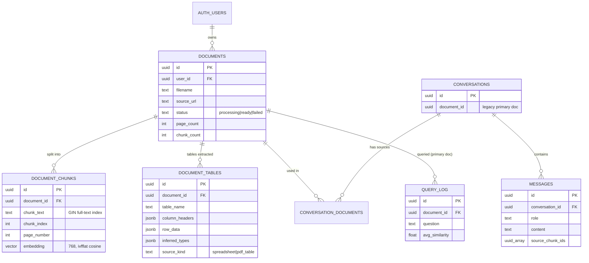

**Indexes** ([schema.sql:111-118](../backend/db/schema.sql#L111-L118)):

| Index | Type | Purpose |
|---|---|---|
| `document_chunks_embedding_idx` | **IVFFlat**, 100 lists, cosine | Approximate nearest-neighbour vector search |
| `document_chunks_document_id_idx` | B-tree | Filter chunks to one document |
| `document_chunks_fts_idx` | **GIN** on `to_tsvector('english', chunk_text)` | Full-text keyword search |

> **📘 Concept: ANN (Approximate Nearest Neighbour) index.** Checking every vector is exact but
> O(n). ANN indexes trade a little accuracy (**recall**) for big speed. **IVFFlat** clusters
> vectors into `lists` buckets and only searches the nearest `probes` buckets (default 1).
> **HNSW** builds a navigable graph. It is usually better recall and speed, has no training step,
> and is slower to build. Section 9 explains why IVFFlat is risky *specifically* for Lumen.

> **📘 Concept: tsvector / tsquery.** Postgres full-text search. `to_tsvector('english', text)`
> turns text into stemmed lexemes (`"policies"` → `polici`), dropping stop words.
> `plainto_tsquery` turns the question into a query, and `@@` tests for a match. `ts_rank` scores it.

The schema is written **idempotently** (safe to re-run) with self-healing migrations. That's thoughtful,
but as the project grows, move to numbered migration files (Supabase CLI migrations) so you
know exactly what state each environment is in.

---

## 8. Security model

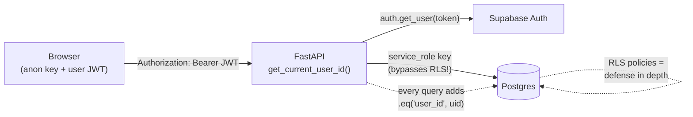

| Control | Where | Assessment |
|---|---|---|
| **Authentication**: every route needs a valid Supabase JWT | [auth.py](../backend/app/auth.py) | ✅ Correct, but it makes a network call per request (latency, section 11) |
| **Authorization / tenant isolation**: every query filtered by `user_id` | [db.py](../backend/app/db.py) | ✅ Correct. Returns 404 not 403 so it doesn't leak existence. Nice touch |
| **RLS (Row-Level Security)** as a second layer | [schema.sql:212-266](../backend/db/schema.sql#L212-L266) | ✅ Good defense in depth. Remember the backend's `service_role` key **bypasses** it |
| **SSRF protection** on URL ingestion | [ingestion.py:24-36](../backend/app/services/ingestion.py#L24-L36) | ✅ Resolves DNS, blocks private IPs, rechecks after redirect. Residual risk: DNS rebinding between check and fetch |
| **No code execution** from LLM output | [spreadsheet.py](../backend/app/services/spreadsheet.py) | ✅ Excellent |
| **Error leakage**: `str(exc)` returned to client | [main.py:55-58](../backend/app/main.py#L55-L58), [chat.py:224](../backend/app/routers/chat.py#L224) | ⚠️ Leaks internals (SQL errors, API messages). Return a generic message + request id |
| **Prompt injection** via ingested web pages | [ingestion.py:231](../backend/app/services/ingestion.py#L231) | ⚠️ A page can contain "Ignore previous instructions and…". Wrap context in clear delimiters, tell the model context is *data, not instructions*, add it to evals |
| **Per-user rate limits** | n/a | ❌ Missing. One user can exhaust the shared Gemini quota |

> **📘 Concept: SSRF (Server-Side Request Forgery).** If your server fetches URLs that users
> provide, an attacker can make it fetch `http://169.254.169.254/` (cloud metadata with secrets)
> or internal services. Lumen blocks this.

> **📘 Concept: Prompt injection.** Malicious instructions hidden inside *data* the LLM reads.
> RAG systems are especially exposed because they paste untrusted documents into prompts.

---

## 9. Senior architect review

### 9.1 What's genuinely good (don't lose these)

1. **LLM plans, code computes.** The structured-query engine is the right architecture for
   numeric questions.
2. **Honest UX.** Similarity scores, page-level citations, explicit refusal, and the
   verified/inferred labels.
3. **Clean layering.** Routers, services, db, config. Every knob lives in one file.
4. **Resilience thinking.** Best-effort table extraction, keyword-only fallback if embedding
   fails ([chat.py:68-74](../backend/app/routers/chat.py#L68-L74)), rate-paced embeddings.
5. **Security basics done right.** Tenant isolation, SSRF checks, 404-not-403.
6. **Whole-document mode for small sources.** A pragmatic answer to "RAG is bad at summaries".

### 9.2 Findings, ranked by impact

Each finding is something I verified in the code.

#### 🔴 High impact on answer quality

**F1. Follow-up questions retrieve with the raw question.** History is given to the *generator*
but not to the *retriever* ([chat.py:182](../backend/app/routers/chat.py#L182) passes `turn.question`).
Ask *"What is the refund policy?"* then *"Does it apply to digital goods?"* and the second search
embeds "Does it apply to digital goods?". "It" means nothing to a vector search, so retrieval
misses. (Whole-document mode hides this bug for small docs. It bites on large ones.)
**Fix: query rewriting (condensation).** Before retrieval, have the LLM rewrite the follow-up
into a standalone question using the history: *"Does the refund policy apply to digital goods?"*.
This is one of the highest-ROI fixes in conversational RAG.

**F2. The hybrid merge mixes incompatible scores.** Semantic scores are absolute cosines
(typically ~0.5-0.85). Keyword scores are divided by the *best keyword hit in this result set*
([retrieval.py:42-49](../backend/app/services/retrieval.py#L42-L49)), so the top keyword match
always scores 1.0 *even if it's a weak match*. Then `0.7a + 0.3b` adds them up as if they were
on the same scale. **Fix: Reciprocal Rank Fusion (RRF)**, which uses ranks, not raw scores:

```
RRF_score(chunk) = Σ over each retriever r of   1 / (60 + rank_r(chunk))
```

RRF is scale-free, needs no weight tuning, and is the industry default (Elasticsearch, OpenSearch
and most vector DBs ship it). Keep the cosine score separately for display in the UI.

**F3. Keyword search ANDs every word.** `plainto_tsquery` requires **every** non-stop-word in the
question to appear in the chunk ([schema.sql:288-291](../backend/db/schema.sql#L288-L291)).
*"What is the refund policy for late orders"* → `refund & polici & late & order`. One missing
word means zero results. Long natural questions almost never match, so the 30% keyword half of
hybrid search is mostly silent. Note that the comment at
[retrieval.py:72](../backend/app/services/retrieval.py#L72) says "try matching by any individual
words", but the code doesn't do that. **Fix:** OR the terms and let `ts_rank` sort:
`replace(plainto_tsquery('english', q)::text, '&', '|')::tsquery`.

**F4. IVFFlat + per-document filter can silently drop results.** With an IVFFlat index, Postgres
may search only `probes = 1` of 100 clusters (~1% of all chunks in the *whole table*, across all
users), *then* apply `WHERE document_id = X`. That can return 2 chunks when you asked for 8.
In whole-document mode ([chat.py:87](../backend/app/routers/chat.py#L87)) it can mean the "whole"
document isn't whole. Also, IVFFlat centroids are computed at index-creation time. This index was
created on an empty table, so its clusters are meaningless. **Fix:** per-document searches
are small (hundreds of chunks), so **exact search is fast enough. Drop the ANN index**, or switch
to HNSW with pgvector's iterative index scans (`SET hnsw.iterative_scan = relaxed_order`). For
whole-document mode, fetch chunks with a plain `SELECT … WHERE document_id = X ORDER BY chunk_index`
and compute similarity in the same query, with no index involved.

**F5. Keyword routing can hijack prose questions.** Any question containing `compare`, `table`,
`chart`, `difference`, `increase`… on a PDF that has *any* extracted table goes down the
structured path. Worse: if the planning LLM call fails (e.g. a 429), `_fallback_plan`
([spreadsheet.py:86-95](../backend/app/services/spreadsheet.py#L86-L95)) builds a `rows` plan on
`tables[0]`, which succeeds, so the user asks *"compare the two approaches in this paper"* and
gets the first table's rows labelled **"Verified data"**. That's the most damaging kind of bug:
a confident wrong answer with a trust badge. **Fix:** (a) only use the fallback when it actually
matched a column name in the question, (b) replace keyword routing with an LLM intent classifier
(can be the same call as F1's rewrite: return `{standalone_question, intent}` in one JSON),
(c) add these cases to the eval set.

#### 🟠 Medium impact

**F6. Chunking ignores structure.** Chunks are fixed 500-token windows that never cross pages
([ingestion.py:160-184](../backend/app/services/ingestion.py#L160-L184)). A sentence that runs
across a page break gets cut in half, and a 520-token page produces a 500-token chunk plus a
70-token orphan. **Fix:** recursive chunking (split on headings → paragraphs → sentences, then
pack up to ~400-600 tokens), and carry page ranges in metadata. Optionally prepend a short
header to each chunk (`"Doc: Q3 report · Section: Revenue"`), a cheap version of
*contextual retrieval*.

**F7. Multi-document retrieval can starve one source.** All documents' chunks compete for one
global top-8 ([chat.py:101-103](../backend/app/routers/chat.py#L101-L103)). For "compare report A
vs B", if A's chunks score slightly higher, B may get zero chunks and the comparison is
one-sided. **Fix:** a per-document quota (e.g. at least 2-3 chunks each), then fill the rest by score.

**F8. "No citation" is hidden instead of flagged.** If the model cites nothing, the code shows
the top-8 closest chunks as sources anyway ([generation.py:80-83](../backend/app/services/generation.py#L80-L83)).
That makes an *uncited* (possibly ungrounded) answer look cited. **Fix:** label it
`unverified`, and track the uncited-answer rate as an online metric.

**F9. History config mismatch.** `CHAT_HISTORY_TURNS = 10` ([config.py:41](../backend/app/config.py#L41))
is never used. `get_conversation_history` defaults to **10 messages = 5 turns**
([db.py:220](../backend/app/db.py#L220)). The README says 10 turns. Also, full past answers
(including chart JSON) are replayed every turn, which bloats tokens.

**F10. The "avg similarity" stat doesn't measure quality.** It averages *all* chunks in
whole-document mode (most are irrelevant by design, so the score drops), logs 1.0 for every
structured answer (inflates it), and only logs the primary document. It's a fine *health*
signal, but don't mistake it for an eval (section 10).

**F11. Refusal detection is exact string match** (`answer != NO_ANSWER_PHRASE`). If the model
says "I don't know based on the provided documents." (plural) or adds a sentence, it isn't
detected as a refusal. Use structured output (`{"answerable": bool, "answer": …}`) or a
normalized check.

#### 🟡 Platform and operability

**F12. No streaming.** ✅ *Fixed:* `POST /chat/stream` streams the answer over Server-Sent Events.
The frontend renders text as it arrives and holds back an unfinished ```` ```chart ```` block until it closes.
Before the fix, the user stared at a typing indicator for the full generation time. (Section 11.)

**F13. Model alias floats.** ✅ *Fixed:* pinned to `gemini-3.5-flash-lite`, the model the alias resolved to
when it was pinned, overridable with `GENERATION_MODEL`. Before the fix, `gemini-flash-lite-latest`
could change underneath you. Your eval scores can shift with no code change. Pin an exact model
version in production and upgrade deliberately, *after* running evals.

**F14. Legacy SDK.** ✅ *Fixed:* every Gemini call now goes through `google-genai` in
[gemini_client.py](../backend/app/services/gemini_client.py), with timeouts, retries and token accounting
handled in one place. Stored embeddings are unchanged (cosine 1.0 against the old SDK). Before the fix: `google-generativeai` is Google's older Python SDK. The current one is
`google-genai`. Migrating also gives you clean access to `system_instruction`, structured
output, context caching and streaming.

**F15. In-process background jobs.** ✅ *Fixed:* uploads go to a private Storage bucket and an
`ingestion_jobs` row. A worker ([worker.py](../backend/app/worker.py)) claims jobs with `FOR UPDATE SKIP LOCKED`,
sends heartbeats while it works, retries transient failures, and reclaims jobs whose worker died. Before the fix: jobs ran as in-process background tasks on a free instance that sleeps. Lost jobs leave documents
stuck in `processing`. (See roadmap: job queue + "stuck job" sweeper.)

**F16. No observability.** ✅ *Fixed:* [tracing.py](../backend/app/tracing.py) writes one structured log line per
request (stage timings, time to first token, tokens, cost) and exports the same tree to Langfuse
when keys are set. Before the fix, there was no per-stage timing, no token counts, no request ids, and no traces.
You can't optimize what you don't measure. This blocks everything in sections 10-12.

**F17. No duplicate detection.** Re-uploading the same PDF re-extracts and re-embeds it (paying
again). Hash the file (SHA-256) and reuse chunks.

---

## 10. Evals: how to measure a RAG system

### 10.1 Why evals are the most important thing you're missing

Right now, every change (TOP_K 5→8, adding whole-document mode, loosening the refusal prompt) is
judged by "I tried a few questions and it looked better." That's **vibes-based development**. It
works for a demo and breaks in production, because:

- A fix for one question silently breaks five others (**regressions**).
- `gemini-flash-lite-latest` changes, and you won't know whether quality went up or down.
- You can't answer "is RRF better than 70/30?" without numbers.

> **📘 Concept: Eval (evaluation).** A repeatable test of output *quality*, run over a fixed
> dataset, producing scores you can compare across versions. Think "unit tests for AI
> behaviour". The answers aren't exactly right or wrong, so you score them instead.

### 10.2 The three layers of a RAG eval

You must evaluate **retrieval and generation separately**, or you can't tell *which half* failed.

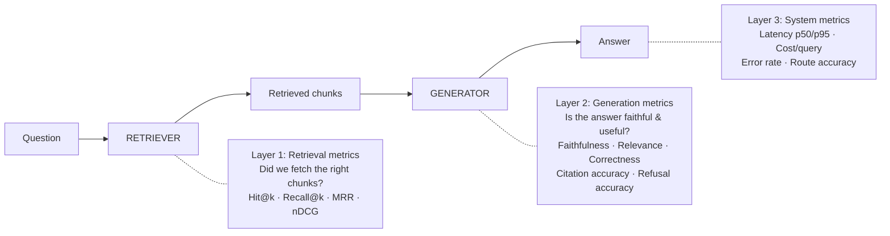

**The diagnostic matrix.** Learn this, it tells you what to fix:

| Retrieval good? | Answer good? | Diagnosis | Fix area |
|---|---|---|---|
| ✅ | ✅ | Working | Ship it |
| ✅ | ❌ | **Generation problem**: model ignored/misread context | Prompt, model choice, context ordering |
| ❌ | ❌ | **Retrieval problem**: right info never reached the model | Chunking, search, query rewriting, rerank |
| ❌ | ✅ | Lucky, or model used outside knowledge (**ungrounded!**) | Grounding prompt; check faithfulness |

### 10.3 Every metric, explained

#### Layer 1: Retrieval

| Metric | Question it answers | How to compute |
|---|---|---|
| **Hit rate @k** | Is *at least one* correct chunk in the top k? | 1 if any relevant chunk in top-k, else 0; average over questions |
| **Recall @k** | What fraction of *all* relevant chunks did we get? | relevant ∩ retrieved / relevant |
| **Precision @k** | What fraction of retrieved chunks are relevant? | relevant ∩ retrieved / k |
| **MRR** (Mean Reciprocal Rank) | How high is the *first* correct chunk? | 1/rank of first relevant (rank 1 → 1.0, rank 4 → 0.25); average |
| **nDCG @k** | Are the *most* relevant chunks ranked highest? | Graded relevance, discounted by position. Use when relevance has levels |

> **💡 Lumen-specific trick:** chunk ids change every time you re-ingest, so label relevance by
> **page number** (or a distinctive quote) instead of chunk id. "The answer is on page 7" is a
> label that survives a chunking change, which is exactly what you need when *comparing*
> chunking strategies.

#### Layer 2: Generation

| Metric | Question it answers | How to judge |
|---|---|---|
| **Faithfulness / Groundedness** | Is every claim in the answer supported by the retrieved context? | LLM judge: split answer into claims, check each against context |
| **Answer relevance** | Does it actually answer *the question asked*? | LLM judge |
| **Answer correctness** | Does it match the known right answer? | Compare against a reference answer (LLM judge or exact match for numbers) |
| **Citation precision** | Do the cited chunks actually support the sentence they're attached to? | LLM judge per citation |
| **Citation recall** | Are factual sentences cited at all? | Count uncited factual sentences |
| **Refusal accuracy** | Refuses when it should, answers when it can | Two rates: **false refusal** (refused an answerable q) and **false answer** (answered an unanswerable q = hallucination) |
| **Route accuracy** (Lumen-specific) | Did tabular vs text routing pick right? | Label expected route per question; exact match |
| **Numeric exactness** (Lumen-specific) | Is the computed number right? | Exact match against pandas-computed ground truth |

> **📘 Concept: Hallucination.** The model states something not supported by its sources. In RAG
> the metric that catches it is **faithfulness**, not correctness. An answer can be *correct
> by luck* from training data yet *unfaithful* to your document.

> **📘 Concept: LLM-as-a-judge.** Using an LLM to grade another LLM's output against a rubric.
> Scales far beyond human grading. Rules for doing it well:
> 1. Use **binary or 3-level rubrics** ("supported / partially / unsupported"), not 1-10 scales. LLMs are poorly calibrated on fine scales.
> 2. Ask for **reasoning before the verdict**.
> 3. Prefer a **stronger or different model** as judge than the one being judged (self-grading is biased).
> 4. **Calibrate:** hand-label ~50 examples yourself, measure judge-vs-human agreement. If it's below ~85%, fix the rubric before trusting the judge.

#### Layer 3: System

| Metric | Why |
|---|---|
| **Latency p50 / p95 / p99** (total, and per stage) | Averages hide pain; p95 is what the unlucky 1 in 20 users feels |
| **TTFT** (time to first token) | Perceived speed, once streaming exists |
| **Tokens in / out per query → $ per query** | Cost regressions are real regressions |
| **Error / timeout rate** | Reliability |

### 10.4 Building your golden dataset

> **📘 Concept: Golden dataset.** A fixed, versioned set of questions with known-good labels.
> It's the "test suite" your evals run against. **Quality over quantity**: 50 well-chosen
> questions beat 1,000 auto-generated ones.

Pick 5-8 real documents that represent your users (a contract PDF, a financial report with
tables, a messy CSV, a multi-sheet XLSX, a web article, a YouTube transcript). Then write
questions in **these categories** (this is where the skill is):

| Category | Example | What it tests |
|---|---|---|
| Single-fact lookup | "What is the notice period?" | Basic retrieval |
| Exact-term lookup | "What does clause 14.2(b) say?" | Keyword half of hybrid |
| Paraphrase | "How long before I can quit?" (doc says "notice period") | Semantic half |
| Multi-hop | "Which region had the highest growth, and who manages it?" | Needs 2+ chunks |
| Broad / summary | "What are the key risks?" | Whole-doc vs top-k behaviour |
| Follow-up | Turn 1: "What's the refund policy?" → Turn 2: "Does it cover digital goods?" | **F1** query rewriting |
| Unanswerable | "What is the CEO's salary?" (not in doc) | Refusal / hallucination |
| Near-miss unanswerable | Doc has 2023 revenue, ask for 2024 | Subtle hallucination |
| Numeric / tabular | "Average revenue in the West region?" | Structured path, exactness |
| Routing trap | "Compare the two methods in this paper" (prose PDF with a table) | **F5** misrouting |
| Multi-doc compare | "How did revenue change from Q2 to Q3 report?" | **F7** source starvation |
| Drafting | "Write an email to the vendor about the late delivery terms" | False-refusal check |
| Injection | Web page containing "ignore your instructions" | Prompt-injection robustness |

**Format** (`backend/evals/golden.jsonl`, one JSON object per line):

```json
{"id": "contract-007", "doc": "sample_contract.pdf", "category": "paraphrase",
 "question": "How long before I can quit?", "answerable": true,
 "expected_pages": [4], "expected_route": "text",
 "reference_answer": "30 days' written notice.", "must_include": ["30 days"]}
{"id": "contract-012", "doc": "sample_contract.pdf", "category": "unanswerable",
 "question": "What is the CEO's salary?", "answerable": false, "expected_route": "text"}
{"id": "sales-003", "doc": "sales.xlsx", "category": "numeric",
 "question": "What is the average revenue in the West region?", "answerable": true,
 "expected_route": "structured", "expected_number": 48213.75}
```

> **💡 Bootstrapping tip:** you can have an LLM *draft* candidate questions from each chunk
> ("write a question this passage answers"), but **you must review every one by hand**.
> Synthetic-only datasets over-represent easy, single-chunk questions.

### 10.5 The eval harness, as a sketch you can grow

> ✅ **Built:** the full harness now lives in [backend/evals/](../backend/evals/README.md). It runs
> the real `chat()` handler with spies, has 43 golden cases, an LLM judge, baseline comparison and
> a CI gate. The sketch below shows the core idea in its simplest form.

Because routers are thin, you can call the pipeline functions directly:

```python
# backend/evals/run_eval.py: run from backend/ with `python -m evals.run_eval`
import json, time, statistics
from app import db
from app.routers.chat import _gather_context
from app.services.generation import generate_answer, NO_ANSWER_PHRASE
from app.services.spreadsheet import is_tabular_question

def load(path):
    return [json.loads(line) for line in open(path) if line.strip()]

def run(cases, doc_by_name):
    rows = []
    for case in cases:
        doc = doc_by_name[case["doc"]]
        t0 = time.perf_counter()
        chunks = _gather_context([doc], case["question"])
        t_retrieve = time.perf_counter() - t0
        result = generate_answer(case["question"], chunks, chat_history=[])
        t_total = time.perf_counter() - t0

        top_pages = [c["page_number"] for c in chunks[:8]]
        refused = NO_ANSWER_PHRASE.lower().rstrip(".") in result["answer"].lower()
        rows.append({
            "id": case["id"],
            "category": case["category"],
            "hit@8": bool(set(case.get("expected_pages", [])) & set(top_pages)) if case.get("expected_pages") else None,
            "route_ok": ("structured" if is_tabular_question(case["question"]) else "text") == case["expected_route"],
            "refusal_ok": refused == (not case["answerable"]),
            "must_include_ok": all(s.lower() in result["answer"].lower() for s in case.get("must_include", [])),
            "latency_retrieve_s": t_retrieve,
            "latency_total_s": t_total,
            "answer": result["answer"],          # for the LLM judge + human review
            "context": [c["text"] for c in chunks],
        })
    return rows

def summarize(rows):
    def rate(key):
        vals = [r[key] for r in rows if r[key] is not None]
        return f"{100 * sum(vals) / len(vals):.0f}%" if vals else "n/a"
    lat = sorted(r["latency_total_s"] for r in rows)
    print(f"hit@8 {rate('hit@8')} | route {rate('route_ok')} | refusal {rate('refusal_ok')} "
          f"| must_include {rate('must_include_ok')} | p50 {statistics.median(lat):.2f}s "
          f"| p95 {lat[int(0.95 * (len(lat) - 1))]:.2f}s")
```

Then add an LLM-judge pass for faithfulness over each `(question, context, answer)`. You can
write it yourself, or use a framework:

| Tool | What it gives you |
|---|---|
| **RAGAS** | Ready-made RAG metrics: faithfulness, answer relevancy, context precision/recall |
| **DeepEval** | Pytest-style LLM tests with built-in metrics; easy CI integration |
| **promptfoo** | YAML-driven prompt/model comparisons, side-by-side diffs |
| **Langfuse / Arize Phoenix** | Tracing + online evals + dataset management (open-source, self-hostable) |

**My advice: write the simple harness yourself first** (above). You'll understand every
number. Adopt a framework once you know what you need from it.

### 10.6 Offline vs online evals, and the improvement loop

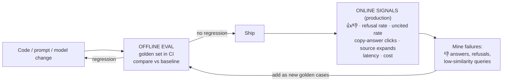

> **📘 Concept: Offline eval.** Run on the golden set before shipping (in CI, on every PR that
> touches `services/` or the prompt).
> **📘 Concept: Online eval.** Signals from real users in production. Lumen already has the
> hooks: add a 👍/👎 on `MessageBubble`, and log refusal rate and uncited-answer rate from
> `query_log`.
> **The flywheel:** every production failure becomes a new golden case, so the same bug can
> never silently return.

**Experiments your eval set lets you answer with data** (in this order):

1. Baseline today's system. Write the numbers down.
2. F3 OR-query keyword fix → does keyword hit-rate rise?
3. F2 RRF vs 70/30 → hit@8 and MRR
4. F1 query rewriting → follow-up category hit@8
5. F6 chunk size 300 / 500 / 800, recursive vs fixed → hit@8, faithfulness
6. Add a reranker (section 13) → MRR, precision@k
7. Whole-doc threshold 60 vs 30 vs 0 → summary-category quality vs cost
8. Model A vs model B → faithfulness, refusal accuracy, cost, latency

---

## 11. Latency

### 11.1 Anatomy of one `/chat` request today

These numbers were **measured** from the trace log lines (section 11.3), on a laptop talking to
Supabase and Gemini, for a single-document text question. The steps run one after another, from
[chat.py:158-199](../backend/app/routers/chat.py#L158-L199):

```mermaid
gantt
    title One /chat/stream request (measured, ms)
    dateFormat X
    axisFormat %s
    section Prepare (before any byte is sent)
    Supabase auth.get_user (network)      :a1, 0, 150
    get_document, conversation, history, tables (serial) :a2, after a1, 2150
    section Retrieval
    embed_query                           :b1, after a2, 550
    search RPCs                           :b2, after b1, 400
    section Generation (streamed)
    Gemini time to first token            :c1, after b2, 900
    remaining tokens arrive as deltas     :c2, after c1, 600
    section After "done" (user is not waiting)
    save_turn + log_query                 :d1, after c2, 400
```

What changed with streaming and the queue:
- **Text appears at first token, not at the end.** On a long summary, the first text showed at
  **5.0 s** and the answer completed at 7.25 s. Before, all 7.25 s was dots.
- **Writes are off the critical path.** The turn is saved in one insert *after* the `done` event,
  and a failed write is logged and retried once. It can no longer turn a finished answer into an error.
- **`prepare` now runs its lookups in parallel** (fixes 5 and 8 below). After the ownership check,
  tables, history and the question's embedding are fetched at the same time. A new conversation skips
  the history query, and a redundant `get_conversation` call is gone. Measured on the same requests:

  | | Before | After |
  |---|---|---|
  | First question: `prepare` / first text | 2,262 / 4,327 ms | 1,175 / 2,555 ms |
  | Follow-up: `prepare` / first text | 2,151 / 3,767 ms | 750 / 1,784 ms |

  What's left in `prepare` is the ownership check followed by creating the conversation (two
  dependent inserts). The next wins are fix 4 (verify JWTs locally) and region co-location.

Two multipliers make it worse:
- **Region distance.** Render runs in `oregon` ([render.yaml](../render.yaml)). If your Supabase
  project is in, say, Mumbai or Frankfurt, *every* DB round trip costs ~150-250 ms instead of
  ~5-20 ms. Ten round trips is 2 seconds of pure distance. **Co-locate backend and DB in the same region.**
- **Cold starts.** The Render free plan sleeps, so the first request costs 30-60 s.

> **📘 Concept: Latency percentiles.** p50 (median) = typical experience. p95 = 1 in 20 requests
> is slower than this. Always optimize and report **p95**; averages hide the tail.

> **📘 Concept: TTFT vs total latency.** *Time to first token* is how long until text starts
> appearing. With streaming, a 4-second answer that starts after 0.8 s *feels* fast. Without
> streaming, it feels like 4 seconds of nothing.

### 11.2 The fixes, ranked by impact per effort

| # | Fix | Saves | Effort |
|---|---|---|---|
| 1 | ✅ **Done.** **Stream the answer** (SSE: `generate_content(stream=True)` → FastAPI `StreamingResponse` → `fetch` + `ReadableStream` in `ChatPanel`). Send sources as a first event, then tokens | Perceived latency drops from *total* to *TTFT* (often 3-5× better feel) | Medium |
| 2 | **Co-locate** Render and Supabase regions; use a paid always-on instance for real users | 100s of ms per request; removes 30-60 s cold starts | Low |
| 3 | **Separate rate budget for queries.** Don't let ingestion's `_TokenBudget` block chat-time `embed_query` | Up to 60 s worst case → ~0 | Low |
| 4 | **Verify JWT locally** (Supabase JWT secret/JWKS, `PyJWT`) instead of `auth.get_user()` network call per request | One round trip on *every* endpoint | Low |
| 5 | ✅ **Done for `prepare`.** **Parallelize independent work.** `embed_query` doesn't depend on history/tables; semantic and keyword RPCs don't depend on each other. Run them concurrently (threads or `asyncio.gather`) | Several round trips | Low-Med |
| 6 | ✅ **Done.** **Move writes off the critical path.** `save_turn` (one insert for both messages) and `log_query` now run after the `done` event | 3 round trips → 0 on the critical path | Low |
| 7 | **One hybrid-search RPC.** Do semantic + keyword + RRF fusion *inside one SQL function* (a CTE per retriever, then fuse) | 1 round trip, and fusion in DB | Medium |
| 8 | ✅ **Done.** **Fetch documents in one query** (`.in_("id", ids)`) instead of N `get_document` calls | N-1 round trips | Low |
| 9 | **Cache query embeddings** (in-memory LRU keyed by normalized question). The 4 starter prompt cards are asked constantly | ~150-300 ms on repeats | Low |
| 10 | **Cap output** (`max_output_tokens`) and **trim history** (summarize old turns) | Generation time scales with output tokens | Low |
| 11 | **Semantic cache** (embed question; if a near-identical question was answered for the *same document set*, return it) | Whole LLM call | Medium (invalidation care) |

> **📘 Concept: Critical path.** The chain of steps the user must wait for. Anything not needed to
> produce the answer (logging, analytics, saving) should be moved *off* it.

### 11.3 Measure first: minimal instrumentation

> ✅ **Implemented** in [tracing.py](../backend/app/tracing.py). Each chat request and ingestion job
> logs one `trace {...}` line with per-stage ms, `first_token_ms`, tokens and cost, and exports
> to Langfuse when `LANGFUSE_PUBLIC_KEY` and `LANGFUSE_SECRET_KEY` are set. The sketch below is
> the idea it grew from.

Add a tiny timer and log one structured line per request:

```python
# app/timing.py
import time, contextlib, logging
log = logging.getLogger("timing")

class Timer:
    def __init__(self): self.spans, self.t0 = {}, time.perf_counter()
    @contextlib.contextmanager
    def span(self, name):
        s = time.perf_counter()
        try: yield
        finally: self.spans[name] = round((time.perf_counter() - s) * 1000)
    def emit(self, **extra):
        log.info({"total_ms": round((time.perf_counter() - self.t0) * 1000), **self.spans, **extra})
```

```python
# in chat():
timer = Timer()
with timer.span("history"):   history = db.get_conversation_history(conversation_id)
with timer.span("retrieve"):  chunks = _gather_context(documents, req.question)
with timer.span("generate"):  result = generate_answer(req.question, chunks, history)
timer.emit(mode="whole" if len(chunks) > TOP_K else "hybrid", n_chunks=len(chunks))
```

Log token usage too (Gemini responses include `usage_metadata` with prompt/output token
counts). Later, graduate to **OpenTelemetry** traces or **Langfuse**, which show every span of
every request as a waterfall.

### 11.4 What the target architecture looks like

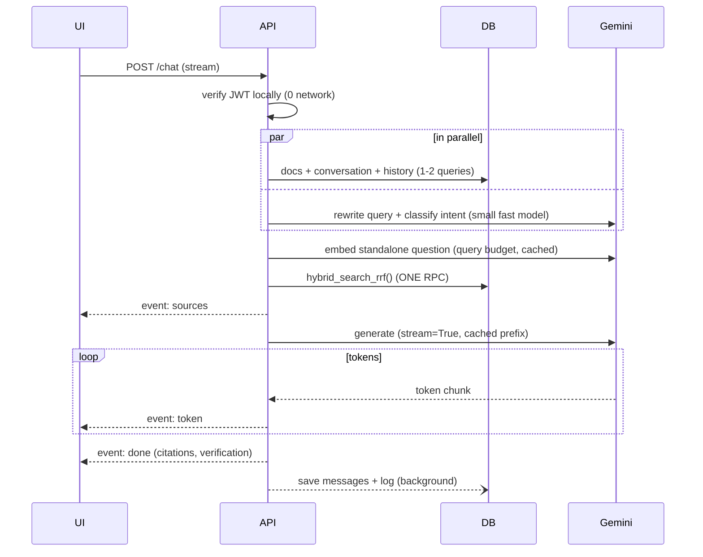

---

## 12. Cost

### 12.1 The formula

```
cost per question = (input_tokens × price_in  +  output_tokens × price_out)   ← generation
                  +  query_tokens × price_embed                               ← tiny
                  + [structured path] planning call                           ← small
cost per document = total_tokens_in_doc × price_embed                         ← one-time
```

Look up current per-million-token prices on Google's Gemini pricing page; they change, and
prices differ by model and tier. The **ratios** below are what matter for design decisions.

### 12.2 Where Lumen's tokens actually go

| Prompt part | Hybrid mode | Whole-document mode |
|---|---|---|
| System instructions | ~700 | ~700 |
| Context chunks | 8 × 500 = **~4,000** | up to 60 × 500 = **~30,000** |
| History (10 messages, full answers) | ~1,000-4,000 | ~1,000-4,000 |
| Question | ~20 | ~20 |
| **Input total** | **~6-9k** | **~32-35k** |
| Output | ~200-800 | ~200-800 |

So whole-document mode costs **~4-5× more input per question** than hybrid. And it is re-sent
**on every turn**: a 10-turn conversation over a 60-chunk doc is ~330k input tokens. On a
"flash-lite" class model that's still cheap per user, but it scales linearly with users, and it
*also* increases latency (more input → slower TTFT).

> **📘 Concept: Input vs output tokens.** Output tokens are typically priced several times higher
> than input tokens and are generated one by one (slow). Input tokens are processed in parallel
> (fast, cheaper). **Long answers cost more and feel slower. Cap them.**

### 12.3 The cost levers, ranked

| # | Lever | Effect | Notes |
|---|---|---|---|
| 1 | **Context caching** | The repeated prefix (instructions + whole-doc chunks) is billed at a steep discount on cache hits | Gemini 2.5+ does *implicit* caching automatically on identical prefixes above a minimum size; *explicit* caching lets you pin a document's context with a TTL. **Lumen's prompt order is already cache-friendly**: keep instructions + chunks first and *byte-identical* across turns. Check `cached_content_token_count` in `usage_metadata` to confirm hits |
| 2 | **Lower the whole-doc threshold, or make it intent-based** | Only use whole-doc for *broad* questions (the intent classifier from F1/F5 tells you); use top-k for specific lookups | Biggest structural saving; measure the quality impact with the "broad/summary" eval category |
| 3 | **Trim and summarize history** | Replace turns older than ~3 with a running summary; strip chart JSON from replayed answers | Saves 1-4k tokens/turn |
| 4 | **Cap output** | `max_output_tokens`, "be concise" instruction | Output is the expensive side |
| 5 | **Model routing (cascade)** | Cheap model for query rewriting / intent / table planning; stronger model only for hard synthesis | Rewrite and classify calls should be tiny |
| 6 | **Dedupe uploads by hash** (F17) | Never re-embed identical files | One-time savings, but real |
| 7 | **Embedding cache for queries** | Repeated prompt-card questions cost nothing | Also a latency win |
| 8 | **Batch API for bulk ingestion** | Providers discount asynchronous batch jobs | For seeding/bulk imports, not interactive uploads |
| 9 | **Reranking narrows context** | Retrieve 30, rerank, send the best 5 instead of 8 → fewer input tokens *and* better precision | Reranker adds its own small cost/latency. Evaluate the net |
| 10 | **Per-user quotas** | Caps worst-case spend; protects the shared key | Also a security control |

> **📘 Concept: Unit economics.** Know your **cost per question** and **cost per active user per
> month**. Log `prompt_token_count`, `candidates_token_count`, `cached_content_token_count`
> per request and you can compute both from `query_log` with a SQL query.

---

## 13. The roadmap

Ordered so each phase gives you the measurement tools the next phase depends on.

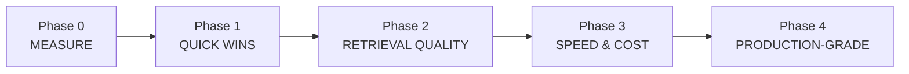

### Phase 0: Measure (do this first, ~2-3 days)
- [ ] Per-stage timing + token-usage logging (section 11.3)
- [ ] Golden dataset: 50-80 cases across the categories in 10.4
- [ ] Eval harness (10.5) + record **baseline numbers** in a `evals/RESULTS.md`
- [x] Pin the generation model version (F13)

### Phase 1: Quick wins (~1 week, each one re-evaluated)
- [ ] F3: OR-based keyword query
- [ ] F2: Reciprocal Rank Fusion
- [ ] F4: drop IVFFlat (exact search per doc) or move to HNSW + iterative scan
- [ ] F5: fix `_fallback_plan` false "verified" answers
- [ ] F9: history uses `CHAT_HISTORY_TURNS`; strip chart JSON from history
- [ ] F8: flag uncited answers as `unverified`
- [ ] Separate query embedding from ingestion rate budget (11.2 #3)
- [ ] Generic error messages to clients (section 8)

### Phase 2: Retrieval quality (~1-2 weeks)
- [ ] **F1 Query rewriting + intent classification** in one small structured-output call:
      `{"standalone_question": "...", "intent": "lookup|broad|tabular|draft|chitchat"}`.
      Use `intent` to replace keyword routing (F5) *and* to choose whole-doc vs top-k (12.3 #2)
- [ ] **F6 Recursive, structure-aware chunking** with contextual chunk headers
- [ ] **F7 Per-document quotas** in multi-doc retrieval
- [ ] **Reranker**: retrieve ~30 candidates with hybrid search, rerank with a cross-encoder
      (e.g. a hosted rerank API or an open model like `bge-reranker`), keep top 5-8

> **📘 Concept: Bi-encoder vs cross-encoder (reranking).** Embedding search is a *bi-encoder*:
> question and chunk are embedded **separately**, so it's fast but shallow. A *cross-encoder*
> reads question + chunk **together** and scores relevance much more accurately, but it's too
> slow to run on every chunk. So: cheap retrieval casts a wide net (top-30), and the expensive
> reranker picks the best (top-5). It's typically the single biggest precision boost in RAG.

### Phase 3: Speed & cost (~1 week)
- [x] Streaming (SSE) end-to-end
- [ ] Local JWT verification
- [ ] Parallelize setup queries; move writes to background; single hybrid RPC
- [ ] Context caching verified via `cached_content_token_count`
- [ ] Query-embedding cache; output caps; history summarization
- [ ] Co-locate regions; always-on instance
- [x] Migrate to the `google-genai` SDK (F14): `system_instruction`, `response_schema`, streaming

### Phase 4: Production-grade (ongoing)
- [x] **Job queue** for ingestion (e.g. a Postgres-backed queue, Redis + RQ/arq, or Celery) + sweeper that fails jobs stuck in `processing` > N minutes (F15)
- [ ] Content-hash dedupe (F17)
- [ ] Per-user rate limits and token quotas
- [ ] OCR fallback for scanned PDFs (already planned in [update.md](../update.md), Phase 4)
- [ ] Prompt-injection hardening + injection cases in the eval set
- [x] Tracing (OpenTelemetry / Langfuse), dashboards for p95 latency, cost/query, refusal rate, 👍 rate
- [ ] Evals in CI: block merges that regress hit@k, faithfulness, or refusal accuracy
- [ ] Numbered DB migrations (Supabase CLI)

### What "advanced" looks like later (don't start here)
- **Contextual retrieval.** An LLM writes a 1-2 sentence context for each chunk at ingestion time ("This chunk is from the termination section of the MSA…"), which is prepended before embedding. Large recall gains, paid for once per document.
- **Hierarchical / parent-child chunking.** Search small chunks for precision, then send their larger parent section for context.
- **Agentic RAG.** The model decides to search again, search another doc, or query a table, in a loop. Powerful, but harder to eval and slower. Earn it with evals first.
- **GraphRAG.** Build an entity/relationship graph for cross-document "connect the dots" questions.

---

## 14. Glossary

| Term | Plain-English meaning |
|---|---|
| **ANN** | Approximate Nearest Neighbour: fast, slightly inexact vector search |
| **BM25** | Classic keyword relevance formula (better than `ts_rank`); available in Postgres via extensions like `pg_search`/ParadeDB |
| **Bi-encoder** | Embeds query and document separately; fast retrieval |
| **Chunk / chunking** | Splitting documents into searchable pieces |
| **Chunk overlap** | Tokens repeated between adjacent chunks so boundaries don't lose meaning |
| **Citation precision/recall** | Are citations correct / are claims cited at all |
| **Cold start** | Delay when a sleeping server wakes up for the first request |
| **Context caching** | Provider reuses computation for a repeated prompt prefix; cheaper and faster |
| **Context window** | Max tokens a model can read in one request |
| **Cosine similarity** | How aligned two vectors are (1 = same meaning) |
| **Critical path** | Steps the user must wait for |
| **Cross-encoder / reranker** | Reads query + chunk together to score relevance precisely |
| **Dense vs sparse retrieval** | Meaning-based (embeddings) vs word-based (keywords) |
| **Embedding** | Vector of numbers representing a text's meaning |
| **Eval** | Repeatable quality test producing comparable scores |
| **Faithfulness / groundedness** | Every claim supported by the provided context |
| **False refusal** | Model says "I don't know" when the answer was in the context |
| **Golden dataset** | Fixed, labelled question set for evals |
| **Grounding** | Constraining answers to provided sources |
| **Hallucination** | Unsupported claim stated as fact |
| **Hit rate @k** | Fraction of questions where a relevant chunk is in the top k |
| **HNSW** | Graph-based ANN index; strong default in pgvector |
| **Hybrid search** | Combining dense + sparse retrieval |
| **Idempotent** | Safe to run multiple times with the same result |
| **Intent classification / routing** | Deciding which pipeline handles a question |
| **IVFFlat** | Cluster-based ANN index; needs data before building |
| **JWT** | Signed token proving who the user is; verifiable locally with the signing key |
| **LLM-as-a-judge** | Using an LLM to grade outputs against a rubric |
| **Matryoshka (MRL)** | Embeddings whose prefix dimensions remain meaningful, allowing truncation |
| **MRR** | Mean Reciprocal Rank: how high the first correct result ranks |
| **nDCG** | Ranking-quality metric with graded relevance |
| **Offline / online eval** | Pre-ship test set vs production signals |
| **p50 / p95 / p99** | Latency percentiles |
| **pgvector** | Postgres extension for vector storage and search |
| **Prompt injection** | Malicious instructions hidden in data the model reads |
| **Query rewriting / condensation** | Turning a follow-up into a standalone question before retrieval |
| **RAG** | Retrieval-Augmented Generation |
| **Rate limit / 429** | API usage cap / "too many requests" error |
| **Recall @k / Precision @k** | Share of relevant chunks retrieved / share of retrieved that are relevant |
| **RLS** | Row-Level Security: Postgres-enforced per-row access rules |
| **RRF** | Reciprocal Rank Fusion: rank-based merge of multiple result lists |
| **Semantic cache** | Reuse answers for semantically identical questions |
| **SSE** | Server-Sent Events: one-way HTTP stream used for token streaming |
| **SSRF** | Tricking a server into fetching internal URLs |
| **Structured output** | Forcing model output to match a JSON schema |
| **Token** | Unit of text LLMs read and bill by (~¾ word) |
| **Top-k** | The k best-scoring results |
| **TPM** | Tokens per minute (rate limit unit) |
| **tsvector / tsquery** | Postgres full-text document / query representations |
| **TTFT** | Time to first token |
| **Vector store** | Database of embeddings searchable by similarity |

---

## 15. How to keep learning

Do these **in this codebase**. Reading teaches you a tenth of what building does:

1. **Build Phase 0 first.** The moment you have a baseline number, every later change becomes an experiment instead of a guess. That habit is the single biggest difference between a junior and a senior AI engineer.
2. **Change one variable at a time** and record results in `evals/RESULTS.md` (date, change, hit@8, faithfulness, refusal accuracy, p95, $/query).
3. **Read failures, not averages.** After every eval run, read the 10 worst cases by hand. Patterns there tell you what to build next.
4. **Learn the concepts in this order:** retrieval metrics → hybrid search & RRF → query rewriting → reranking → chunking strategies → LLM-as-judge calibration → caching & streaming → agentic patterns.
5. **Primary sources worth reading:** the pgvector README (indexing + filtering sections), the Postgres full-text search docs, Google's Gemini docs on embeddings, context caching and structured output, and the RAGAS docs on metric definitions.

> **The mindset in one line:** *Retrieval decides what's possible, generation decides what's
> said, evals decide what's true, and latency and cost decide whether anyone can use it.*
